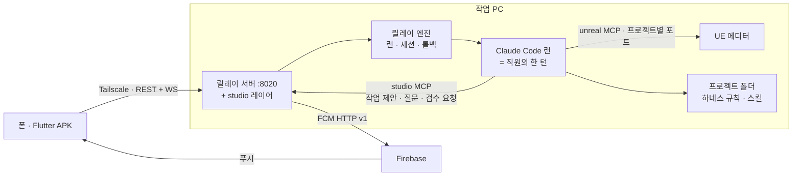
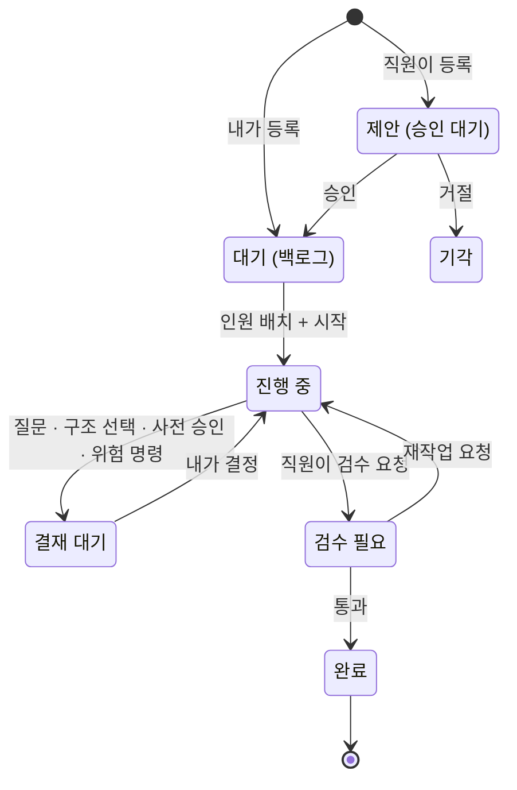

# 카태 스튜디오 (가칭) — 캠페인 작업 리스트

릴레이 서버(Agent 카태) 위에 **회사 레이어**를 얹고, Flutter APK 로 집 밖에서 게임 프로젝트를 만들고 · 시키고 · 검수한다.

- 작성: 2026-10-10 · 상태: **큰 결정은 확정. §6 은 기본값 — 바꾸려면 P-5 전에**
- 기준 코드: relay-agent `origin/main` c5edc75 (2026-10-02). **이 PC 의 체크아웃은 17커밋 뒤(38e7a16)라 캠페인 릴레이가 없다 — 먼저 `update.bat`**
- 작업 수: 54 (준비 5 · 서버 14 · 컴퓨터/프로젝트 8 · 인사 6 · 알림 3 · 앱 13 · 검증 5)

## 0. 전제

**확정 (2026-10-10)**

| 항목 | 결정 |
|---|---|
| 백엔드 | relay-agent 확장. Buzz 는 개념(에이전트=멤버, 채널/DM, 페르소나, 승인 게이트)과 모바일 화면 구성만 참고 |
| 앱 | Flutter (Android APK) |
| 외부 접속 | Tailscale (서버를 인터넷에 열지 않는다) |
| 푸시 | FCM (서버가 HTTP v1 로 직접 발송) |
| 치명 동작 | 2단계 — 차단 / 물어보고 진행. 목록은 §7 |
| 문서 · 데이터 권한 | 직원이 직접 쓴다. 결재가 필요해 보이면 직원이 스스로 올린다. 그 기준은 프로젝트 특징과 인사 면담으로 정한다 (H-6) |
| 새 프로젝트 플러그인 | Unreal MCP + YSTagUsage |
| 사용량 조절 | 직원 · 단계별 **모델과 노력치 지정**이 주 수단. 한도는 느슨한 안전망으로만 둔다 |
| 진행 방식 | 3가지를 옵션으로 두고 내가 고른다. 도중에 바꿀 수 있다 (§5) |

**확인된 현황 (2026-10-10, 이 PC 에서 직접 확인)**

- 릴레이(`origin/main` 기준): FastAPI `:8020`, 세션 · 런 · 승인 · 롤백. **이미 있는 것** —
  - 캠페인 릴레이(`relay_agent/campaign.py`): 계획 → 작업마다 릴레이 → 미해결 이슈는 마무리 작업 → 사용량 대기 · 서버 재시작 복구. `/campaigns` API, 일시 정지 · 재개 · 건너뛰기.
  - 원격: `relay remote on --tailscale`(tailnet 주소 + 토큰만 통과), `relay autostart on`(로그인 시 시작 + 죽으면 다시 띄우는 supervisor), 폰에서 되는 토큰 입력.
  - 모델: 단계별 모델 · 노력치 지정, 상한(`model_cap` / `effort_cap`), `GET /models`.
  - 릴레이 종류: auto(요청을 보고 고름) · doc-write · editor-task · game-cycle · skill-make.
  - **없는 것**: 직원 · 방 · 결재함 · 검수 단계 · 푸시. 알림은 Windows 토스트뿐(`relay_agent/notify.py`).
- 같은 폴더를 제자리(inplace)로 고치는 런은 **한 번에 하나** (`RelayEngine._acquire_folder`).
- Unreal MCP: `MNYS/Plugins/Unreal-MCP-main`, `Config/DefaultEngine.ini` 의 `[UnrealMCP] Port=55557`. 파이썬 쪽은 `UNREAL_MCP_PORT` 환경 변수 → 없으면 **cwd 기준** `Saved/UnrealMCP/port.txt` 로 포트를 찾는다 (`unrealmcp/_tcp_bridge.py`).
- YSTagUsage: 에디터 전용, 엔진 기본 플러그인 `GameplayTagsEditor` 만 의존, MNYS 코드 참조 없음. README 상 **UE 5.7 만 확인됨**. 원격 `github.com/jokate/YSTagUsage`.
- 엔진: 실제로 설치된 것은 5.6(`D:\Epic\UE_5.6`) · 5.7(`C:\Unreal\UE_5.7`) 둘이다. 레지스트리 `HKLM\SOFTWARE\EpicGames\Unreal Engine` 에는 4.0 · 4.27 · 5.1 키도 남아 있지만 폴더가 없다 (2026-10-11 정정 — 처음에는 레지스트리만 보고 넷이라고 적었다). MNYS 는 5.7.
- 하네스: 프로젝트 규칙 파일(`CLAUDE.md`/`CLAUDE.local.md`)이 없으면 스킬이 사실상 안 불린다 (game-harness `docs/GUIDE.md` 4절) → 새 프로젝트는 bootstrap 이 필수.
- 모바일 툴체인: Flutter · adb · Tailscale 없음, JDK 는 11 뿐. `%LOCALAPPDATA%\Android\Sdk` 폴더는 있음.

**검증 안 됨 (작업 안에서 먼저 확인할 것)**: 헤드리스 릴레이 런에서 하네스 이벤트 로그가 남는지(S-11) · 엔진 `Templates/` 로 C++ 프로젝트를 CLI 생성할 수 있는지(M-3) · 플러그인 폴더명이 `UnrealMCP` 여야 하는지(M-4) · 캠페인 플래너가 이 문서의 작업 단위를 얼마나 그대로 따르는지(§5).

## 1. 구조



핵심 설계 5가지 — 이후 작업은 이 전제를 따른다.

1. **직원 = 페르소나 파일 + 전용 대화 + 모델 설정.** `PERSONA.md`(정체성) · `GUIDE.md`(파트 지침 · 결재 기준) · `MEMORY.md`(배운 점) · `employee.yaml`(파트 · 릴레이 · MCP · **채팅용과 작업 단계별 모델 · 노력치**). 직원×방마다 Claude Code 대화 하나를 이어 쓴다(`--resume`).
2. **직원은 studio MCP 로 회사에 행동한다.** 작업 제안 · 나에게 질문 · 방에 글쓰기 · 검수 요청은 전부 도구 호출이고, 서버가 상태 전이와 알림을 결정론적으로 처리한다.
3. **기다림 = 런 종료.** 결재가 필요하면 프로세스를 붙잡지 않고 런을 끝낸다. 내가 결정하면 같은 대화를 resume 한다 (서버 재시작에도 안전, 대기 중 토큰 0).
4. **권한은 공통 전권, 담당은 지침.** 모든 직원이 같은 권한 프로파일을 쓰고, 치명 동작만 훅이 막는다. 파트는 "무엇을 해야 하나"를 정하고, 담당 밖 변경은 막지 않고 검수 화면에 표시한다.
5. **결재는 두 종류다.** *강제 결재*는 서버와 훅이 멈춘다(직원의 작업 등록, 구조 선택, 위험 명령, 최종 검수) — 보장된다. *판단 결재*는 직원이 기준에 비춰 스스로 올린다(H-6) — **모델 판단이라 보장이 아니다.** 그래서 검수 화면에서 "묻지 않고 처리한 것"을 사후 점검하고 기준을 고쳐 나간다.

## 2. 도메인 모델과 작업 상태

| 개념 | 내용 |
|---|---|
| 컴퓨터 | 릴레이 서버 한 대. 앱은 여러 대를 등록하고 직접 붙는다 (중앙 서버 없음) |
| 프로젝트 | UE 프로젝트 폴더 + 엔진 버전 + MCP 포트 + 릴레이 repo 이름 + 프로젝트 정책(결재 기준) |
| 파트 | 인사(기본) · 기획(문서) · 프로그램 · 기획(세팅) · 사용자 추가. 지침 템플릿과 모델 기본값을 가진다 |
| 직원 | 회사(컴퓨터) 소속, 프로젝트에 배치. 모델 · 노력치 설정. 상태: 대기 / 작업 중 / 결재 대기 / 휴직 |
| 방 | 1:1(나↔직원) · 작업방(나+배치 인원) · 파트방 · 시스템 공지 |
| 캠페인 | 목표를 가진 작업 묶음. 진척률과 **진행 방식**(무정차 / 고비 정차 / 작업마다 정차)을 가진다 |
| 작업 | 제목 · **사유** · **명세** · **완료 기준** · 유형(feature/fix/chore/doc/data) · 제안자 · 담당 · 부모 작업 · 선행 작업 · 고비 표시 |
| 결재 | 작업 제안 · 채용 · 설계 승인 · 구조 선택 · 질문 · 사전 승인(직원 판단) · 예산 · 위험 명령 · 최종 검수 |



규칙: 직원은 `완료`로 직접 못 보낸다(반드시 `검수 필요` 경유). 후속 작업은 상태 전이가 아니라 **부모가 연결된 새 작업**이며, 직원이 만들면 `제안`부터 시작한다.

## 3. 요청 플로우 ↔ 작업 대응

| 요청 | 작업 |
|---|---|
| 1. 컴퓨터 연결 | P-1, M-1, M-2, A-3 |
| 2. 프로젝트 생성 + MCP + 포트 | M-3, M-4, M-5, M-6, M-8, A-4 |
| 3. 파트 추가 · 인사와 질의응답으로 직원 생성 · 지침 생성 | H-1, H-2, H-3, A-6 |
| 4. 직원과 채팅 | S-6, S-7, A-7 |
| 5. 직원의 작업 등록(내 승인) · 사유/명세 | S-2, S-5, S-6, A-8, A-9 |
| 6. 작업 지정 · 인원 배치 · 에이전트 간 소통 | S-8, S-9, H-5, A-8 |
| 7. 후속 작업 개설 | S-12, A-10 |
| 8. 치명 동작 제외 전권 | S-10 |
| 9. 진행 중 → 검수 필요 → 완료 | S-2, S-12, A-10 |
| 작업 사이클을 일일이 요청하지 않기 · 진행 방식 선택 | 기존 캠페인 릴레이, S-14, A-8 |
| 직원이 판단해서 올리는 결재 | H-6, S-12, A-9, A-10 |
| 직원별 모델 · 노력치 | H-1, H-2, S-7, S-8, A-6, A-8 |
| 하네스 원칙 보장 | M-5, S-11 |
| 진척 관리 · 캠페인 | S-13, S-14, A-5, A-8 |
| 알림 | N-1, N-2, N-3, A-11 |
| 카톡형 레이아웃 · 화려한 디자인 · 타이쿤 | A-1, A-5, A-6, A-7 |

## 4. 작업

표기: **사유**(왜) · **명세**(무엇) · **완료**(검증 기준) · 의존 · 저장소(`server` = relay-agent, `app` = 앱 저장소) · 릴레이. `[사람]` 은 내가 직접 한다. `결재` 는 결과물을 내가 승인해야 다음으로 간다.

### P. 준비

**P-1 [사람] Tailscale 연결**
- 사유: 서버를 인터넷에 노출하지 않고 폰에서 붙는다.
- 명세: PC · 폰에 Tailscale 설치, 같은 계정 로그인 → `uv run relay remote on --tailscale` → `uv run relay autostart on`. 주소와 토큰은 `uv run relay remote status` 가 알려 준다.
- 완료: 폰(모바일 데이터)에서 그 주소의 대시보드가 토큰을 묻는다.

**P-2 [사람] Firebase 프로젝트**
- 사유: FCM 발송에 프로젝트와 키가 필요하다.
- 명세: Firebase 프로젝트 생성 → Android 앱 등록(패키지 `com.jokate.studio`, 가칭) → `google-services.json` 은 앱 저장소 `android/app/`, 서비스 계정 키는 저장소 밖 `%USERPROFILE%\.katae\fcm-service-account.json`.
- 완료: 두 파일이 제자리에 있고 git 에 잡히지 않는다.

**P-3 모바일 툴체인** · server · quick
- 사유: Flutter · adb 가 없고 JDK 가 11 이다.
- 명세: Flutter stable, JDK 17, Android cmdline-tools · platform · build-tools 설치(기존 SDK 폴더 재사용), PATH 등록. **SDK 라이선스 동의는 [사람]** 이 한다.
- 완료: `flutter doctor` 의 Flutter · Android toolchain 통과, 빈 앱이 `flutter build apk --debug` 성공.

**P-4 저장소와 릴레이 등록** · quick
- 사유: 서버와 앱을 다른 저장소로 두면 런을 병렬로 돌릴 수 있고, 앱 작업이 돌아가는 서버 코드를 건드리지 않는다.
- 명세: (a) relay-agent 를 `studio-server` 로 등록 (`copy`, verify `uv run pytest -q`). (b) 앱 저장소 `jokate-studio-app` 을 `flutter create --org com.jokate` 로 만들고 `studio-app` 으로 등록 (`copy`, verify `flutter analyze`, `flutter test`). (c) 비밀은 `%USERPROFILE%\.katae\` 에만 둔다는 규칙을 두 저장소 `.gitignore` · README 에 적는다.
- 완료: `uv run relay repos` 에 둘 다 보이고 verify 가 각각 통과.

**P-5 기준 설계 문서** · server · default · **결재**
- 사유: 릴레이의 각 단계는 HANDOFF 만 받는다. 작업들이 같은 계약을 보려면 문서가 기준이어야 한다.
- 명세: `design/studio/ARCHITECTURE.md` — 이 문서 §1–2 를 풀어 쓴다: 테이블 정의, 상태 전이 표(누가 · 언제 · 부수 효과), 결재 종류별 payload, REST · WS 계약, studio MCP 도구 시그니처, `employee.yaml` 형식(모델 · 노력치 포함), 권한 프로파일, 디렉터리 배치(`relay_agent/studio/`, 데이터는 `runs/studio/`).
- 완료: 내가 읽고 승인. 이후 모든 작업은 이 문서의 절 번호를 인용한다.
- 의존: §6 을 바꿀 것이 있으면 이 작업 전에.

### S. 서버 — 회사 레이어 (`relay_agent/studio/`)

공통 규칙: 새 코드는 `relay_agent/studio/` 에 넣고 기존 `pipeline.py` · `runners.py` 에는 연결 지점만 추가한다. 모든 작업의 verify 는 `uv run pytest -q`. 테스트는 `demo` 릴레이(mock, 토큰 0)로 돌린다.

**S-1 저장소와 스키마** · default
- 사유: 회사 상태(직원 · 방 · 작업 · 결재)를 둘 곳이 없다. 기존 `history.sqlite` 는 세션 · 턴 · 이벤트뿐이다.
- 명세: `runs/studio/studio.sqlite` — projects, departments, employees, rooms, room_members, messages, campaigns, tasks, task_deps, task_events, inbox, devices. 스키마 버전 + 순차 마이그레이션. 저장소 클래스는 `HistoryStore` 와 같은 형태(스레드 잠금, dict 반환).
- 완료: 빈 DB 생성 → 마이그레이션 → 각 테이블 CRUD 테스트 통과. 서버를 두 번 띄워도 마이그레이션이 한 번만 돈다.
- 의존: P-5

**S-2 작업 · 캠페인 상태기계** · default
- 사유: "직원 등록은 내 승인", "자동 완료 금지"는 규칙이지 관례가 아니어야 한다.
- 명세: §2 전이만 허용, 그 외는 예외. 전이마다 `task_events` 에 누가 · 언제 · 왜를 남긴다. 작업 생성 시 사유 · 명세 · 완료 기준이 비면 거부. 직원 주체는 `done` 전이 불가.
- 완료: 허용 전이 전부 + 금지 전이 전부(직원→완료, 제안→진행 중 등)를 테스트로 덮는다.
- 의존: S-1

**S-3 REST API** · default
- 사유: 앱과 대시보드가 같은 계약으로 붙는다.
- 명세: `/studio/*` — machine, projects, departments, employees, rooms(+messages 페이지네이션), campaigns, tasks(+전이 액션), inbox(+decide), devices. 기존 토큰 가드를 그대로 탄다. OpenAPI 를 `design/studio/openapi.json` 으로 내보내는 명령을 둔다.
- 완료: 엔드포인트별 테스트 + 토큰 없는 원격 호출 401. `openapi.json` 이 저장소에 있고 최신인지 비교하는 테스트가 있다.
- 의존: S-2

**S-4 실시간 스트림** · default
- 사유: 채팅과 "지금 뭐 하는 중"을 폴링 없이 본다.
- 명세: `WS /studio/ws` (토큰 인증, 재접속 시 `after_id` 로 이어 받기). 이벤트: 메시지, 작업 전이, 결재 생성/결정, 직원 상태, 런 liveness(기존 `/runs/{id}/live` 내용).
- 완료: 끊었다 붙어도 빠진 이벤트 없이 순서대로 받는 테스트.
- 의존: S-3

**S-5 결재함** · default
- 사유: 승인 · 질문 · 검수가 흩어지면 폰에서 결정할 수 없다. 한 곳에 모은다.
- 명세: 결재 종류 9가지(§2)의 payload 스키마와 결정 → 후속 동작 디스패치. 기존 런 승인 대기 · 예산 초과(`awaiting_approval`, `budget_exceeded`)도 결재로 들어오게 연결한다. 결정에는 코멘트와 수정 요청을 실을 수 있다.
- 완료: 종류별로 "생성 → 결정 → 후속 동작(작업 전이 · 런 resume · 직원 생성)"이 테스트로 확인된다. 같은 결재를 두 번 결정하면 두 번째는 거부.
- 의존: S-2

**S-6 studio MCP 서버** (`mcp_servers/studio.py`) · default
- 사유: 직원이 회사에 행동하는 유일한 통로다. 프롬프트 약속이 아니라 도구로 만든다.
- 명세: `task_propose` · `task_get` · `task_list` · `task_progress` · `task_request_review(summary, checklist, evidence, judgment_calls)` · `followup_propose` · `ask_owner(kind = question | choice | approval, …)` · `room_post(room, text, mentions)` · `employee_list`. 인사 전용: `employee_draft` · `employee_submit` · `policy_draft`. 호출자는 런에 주입된 직원 ID 로 식별한다(남을 사칭할 수 없다). `ask_owner` 와 `task_request_review` 는 "이제 턴을 끝내라"를 돌려준다.
- 완료: 도구별 테스트 + 다른 직원 ID 로 호출 시 거부.
- 의존: S-5

**S-7 직원 실행기 — 채팅** · default
- 사유: 직원에게 말을 걸면 그 직원의 지침과 기억으로 답해야 한다.
- 명세: `relays/employee-chat.yaml`(단일 단계). 프롬프트 = PERSONA + GUIDE + MEMORY + 프로젝트 정책 + 방의 최근 메시지 요약. 모델 · 노력치는 `employee.yaml` 의 `chat` 값. 직원×방 대화를 `--resume` 으로 잇고, 길어지면 HANDOFF 로 요약해 새 대화로 넘긴다. 답은 방 메시지로 저장. **unreal MCP 는 기본 끔** — 연결만으로 턴당 +15–25K 토큰이다(README 실측). 직원이 필요하다고 하면 그 턴만 켠다. 인사가 생기기 전 검증용으로 **시드 직원 1명**을 파일로 둔다.
- 완료: mock 러너로 "메시지 → 직원 답 → 방에 저장 → WS 이벤트" 테스트. 실제 Claude 로 2턴 대화가 이어지는지 수동 확인 1회.
- 의존: S-4, S-6

**S-8 작업 실행 · 큐 · 폴더 락** · default
- 사유: 같은 프로젝트를 두 직원이 동시에 고치면 릴레이가 거부한다(폴더 락). 거부가 아니라 줄을 세워야 한다.
- 명세: 작업은 **기존 릴레이**로 돌린다 — 파트 기본값(H-1) 또는 `auto` 가 고른 것에 직원 지침 · 메모리 · 프로젝트 정책을 프롬프트로 얹는다. 단계별 모델 · 노력치는 `employee.yaml` 의 `work` 값이고, 작업을 시작할 때 **이번만 덮어쓸 수 있다**(기존 `stage_models`, 상한은 `model_cap` / `effort_cap`). 고를 수 있는 값은 `GET /models` — 지금 쓸 수 있는 모델과 그 모델이 지원하는 노력치만. 프로젝트별 쓰기 큐 1줄 + 전체 동시 실행 한도(§6-1). 읽기 전용 턴(`workspace: none`)은 큐를 타지 않는다. 런 비용 정지 값은 구독 사용을 전제로 넉넉히 잡는다(설정값). MCP 를 쓰는 작업은 시작 전에 에디터 상태를 확인한다(M-7). 서버 재시작 시 큐와 직원 상태를 복구한다.
- 완료: 같은 프로젝트 작업 2개를 동시에 시작 → 순차 실행. 서버를 죽였다 띄워도 큐가 이어진다. 직원 설정과 덮어쓴 값이 실제 런의 모델 · 노력치로 들어가는지 확인.
- 의존: S-7

**S-9 직원 간 소통** · default
- 사유: 배치된 직원들이 서로 묻고 넘기며 일해야 한다. 다만 서로 떠넘기며 도는 경우는 끊을 수 있어야 한다.
- 명세: 작업방에서 `room_post(mentions=[직원])` → 그 직원의 턴을 큐에 넣는다. 쓰기 권한은 작업의 현재 담당 1명, 나머지는 읽기 전용 턴. 안전망: 작업당 직원 간 왕복 한도(§6-1) — 넘으면 `ask_owner` 결재로 멈춘다. 내가 방에 쓰면 최우선으로 끼어든다(기존 interject).
- 완료: mock 직원 2명이 3왕복 후 검수 요청하는 시나리오 테스트. 한도 초과 시 결재가 생기고 런이 멈춘다.
- 의존: S-8

**S-10 권한 프로파일과 치명 가드** · default
- 사유: "치명적인 것 빼고 전권"은 모델 판단에 맡길 수 없다. 훅으로 강제한다.
- 명세: 프로파일 `studio-full` — 편집 · 셸 · MCP 사전 승인. PreToolUse 훅 `studio_guard.py` 가 §7 의 **차단 목록**은 거부, **물어보고 진행 목록**은 런을 멈추고 결재함으로 보낸다. 모든 판정을 감사 로그에 남긴다. 가드 파일 자체와 서버 설정은 직원이 못 고친다.
- 완료: 목록의 항목마다 "명령 예시 → 기대 판정" 테스트. 우회 변형(경로 표기 바꾸기, 체인 명령, PowerShell/cmd/bash 각각) 포함.
- 의존: S-5

**S-11 하네스 준수 게이트 (프로그램 파트)** · default
- 사유: Jokate-Harness 의 원칙 — 구조는 사람이 고른다, 완료 기준 먼저, 검증 안 된 것은 그렇게 쓴다 — 을 직원 성실성에 기대지 않는다.
- 명세: (0) **먼저 확인** — 헤드리스 릴레이 런에서 하네스 이벤트 로그와 스킬 호출이 기록되는지. 안 되면 기록 방법부터 만든다. (1) bootstrap 안 된 프로젝트에는 프로그램 직원을 배치할 수 없다. (2) `feature` 유형 작업은 구조 선택 결재(선택지 A/B/C + 근거 그림) 없이 코드가 바뀌면 `검수 필요`로 못 간다. (3) 검수 요청에는 완료 기준별 `검증됨(자동/수동)` / `검증 안 됨` 표기가 필수. (4) MCP 가드 경고를 수집한다.
- 완료: 구조 선택 없이 코드를 바꾼 mock 런이 검수 요청에서 거부된다. 실제 MNYS 에서 `feature` 작업 1건이 구조 선택 결재를 만든다(수동 확인).
- 의존: S-6, M-5

**S-12 검수 패키지 · 재작업 · 후속 작업** · default
- 사유: 폰에서 통과/반려를 정하려면 근거가 한 화면에 있어야 한다.
- 명세: 검수 요청 시 패키지 생성 — 한 줄 요약, 완료 기준별 검증 표기, 변경 파일과 patch(기존 `result.patch`), 애셋 변경 목록(기존 journal), 스크린샷, 하네스 체크(S-11), **담당 밖 변경**, **묻지 않고 처리한 판단**(직원이 `judgment_calls` 로 자진 기재), 비용. 결정: 통과 / 재작업(코멘트가 같은 대화로 들어감) / 되돌리기(기존 rollback). 통과 시 git 커밋(푸시 없음). 직원의 `followup_propose` 는 부모가 연결된 `제안`이 된다. 기존 캠페인의 자동 마무리 작업(`max_followups`)은 같은 작업의 남은 이슈를 닫는 재시도로 두고, **범위가 늘어나는 것만** 후속 작업으로 올려 승인을 받는다.
- 완료: 통과 · 재작업 · 되돌리기 각 경로 테스트. 재작업이 새 대화가 아니라 기존 대화를 잇는지 확인.
- 의존: S-9

**S-13 진척 집계와 일일 보고** · quick
- 사유: 프로젝트가 어디까지 왔는지 채팅을 다 읽지 않고 안다.
- 명세: 캠페인 진척률(상태별 개수 · 완료율), 직원별 처리량 · 사용량, 결재 평균 대기 시간. 하루 1회 인사 직원 이름으로 시스템 방에 "한 일 / 막힌 것 / 결재 대기" 요약(가벼운 모델 1회).
- 완료: 집계 API 테스트. 일일 보고가 세 줄 형식을 지킨다.
- 의존: S-2

**S-14 캠페인 자동 진행과 진행 방식** · default
- 사유: 기존 캠페인은 사이클을 대신 돌려 주지만 직원 · 검수 · 선행 · 진행 방식을 모른다. 얼마나 맡길지는 써 보며 정할 일이라 옵션으로 둔다.
- 명세: **기존 `relay_agent/campaign.py` 를 확장한다(새로 만들지 않는다).** 지금 캠페인은 플래너가 나눈 목록을 한 폴더에서 순서대로 돌리고 실패 · 비용 · 승인에서만 멈춘다. 더할 것: 스튜디오의 작업 목록(내가 승인한 것)을 플래너 없이 그대로 실행, 작업마다 담당 직원, 선행 관계와 고비 표시, 진행 방식 3종(§5 표) — 선행 조건이 차면 다음 작업을 자동으로 시작한다(담당이 정해진 작업만. 미정이면 "배치 필요"로 알림). **도중 변경 가능**(다음 시작부터 적용). 어느 방식이든 결재는 그 작업만 멈추고 다른 줄기는 계속 간다. 무정차 중 선행 작업을 내가 반려하면, 그것에 기대어 이미 진행된 작업에 "선행 반려" 표시와 알림.
- 완료: mock 캠페인(직렬 2 + 병렬 1 + 고비 1)을 세 방식으로 돌려 시작 순서와 멈춘 곳이 기대와 같다. 도중 변경, 선행 반려 표시 테스트. 기존 `tests/test_campaign.py` 는 그대로 통과한다.
- 의존: S-8, S-12

### M. 컴퓨터 · 프로젝트

**M-1 컴퓨터 진단 API** · server · quick
- 사유: 앱에서 "이 PC 가 일할 수 있는 상태인가"를 본다.
- 명세: `GET /studio/machine` — `relay doctor` 결과, 설치된 엔진 목록(레지스트리), 디스크 여유, AI 사용량(기존 `/providers`), 실행 중 에디터, 서버 코드 버전.
- 완료: 이 PC 에서 레지스트리의 엔진 키가 모두 나오고, 폴더가 있는 5.6 · 5.7 만 설치된 것으로 표시된다.

**M-2 기기 페어링** · server · default
- 사유: 토큰 하나를 손으로 옮기면 폰을 잃었을 때 전부 바꿔야 한다.
- 명세: 대시보드에서 1회용 페어링 코드가 든 QR 표시(5분 만료) → 앱이 기기 이름 · FCM 토큰과 함께 교환 → 기기별 토큰 발급. 기기 목록 · 폐기. 접속 제한은 기존 `relay remote on --tailscale` 을 그대로 쓰고, 공용 토큰 하나뿐인 지금 구조에 기기별 토큰을 더한다(공용 토큰은 대시보드용으로 유지).
- 완료: 만료 · 재사용 코드 거부, 폐기한 기기 토큰 401 테스트.
- 의존: S-3

**M-3 UE 프로젝트 생성기** · server · default
- 사유: 폰에서 "새 프로젝트" 한 번으로 빌드되는 C++ 프로젝트가 나와야 한다.
- 명세: 입력 = 이름 · 엔진 버전 · 부모 폴더. 템플릿 = 저장소의 최소 C++ 스켈레톤(`.uproject`, 런타임 모듈, Target 2개, `Config/Default*.ini`, `Docs/` 골격)에 이름 치환. **먼저 확인**: 엔진 `Templates/` 로 같은 일을 할 수 있는지 — 되면 그쪽을 쓴다. 생성 후 프로젝트 파일 생성 + 에디터 타깃 빌드. 이름 · 경로 검증(공백 · 한글 · 기존 폴더).
- 완료: 5.7 로 만든 프로젝트가 에디터 타깃 빌드에 성공한다(실제 실행, 수동 확인 1회).
- 의존: M-1

**M-4 플러그인 설치기 (Unreal MCP + YSTagUsage)** · server · default
- 사유: 요청 사항 — MNYS 의 MCP 를 새 프로젝트에 꽂고 포트를 잡는다. YSTagUsage 도 기본으로 넣는다.
- 명세: 설치 목록은 설정값이고 생성 화면에서 체크로 고른다. 기본 = Unreal MCP(`MNYS/Plugins/Unreal-MCP-main`) + YSTagUsage(`MNYS/Plugins/YSTagUsage`). 복사 시 `.git` · zip 제외, `.uproject` 에 등록. **YSTagUsage 는 5.7 만 확인됐다** — 다른 엔진이면 기본 해제하고 경고한다. MCP 는 추가로: `DefaultEngine.ini` 에 `[UnrealMCP] Port=<할당>`, 포트는 서버가 프로젝트별로 배정(MNYS 55557, 이후 55558+, 사용 중이면 건너뜀), 프로젝트 `.mcp.json` 에 `UNREAL_MCP_PORT` 고정 — 하위 폴더나 복사본에서 돌면 `port.txt` 를 못 찾기 때문. `.claude/mcp_guards.json` 은 MNYS 것에서 프로젝트 무관 규칙만 골라 기본본으로.
- 완료: 새 프로젝트 에디터에서 `health_check` 가 배정 포트로 응답하고, 툴 메뉴에 태그 사용처 탭이 뜬다(수동 확인). MNYS 와 동시에 띄워도 포트가 섞이지 않는다.
- 의존: M-3

**M-5 하네스 · 인덱스 · 릴레이 등록 · git** · server · quick
- 사유: 규칙 파일이 없으면 하네스가 꺼져 있다. 프로젝트 생성의 일부여야 한다.
- 명세: game-harness `bootstrap.bat <폴더>` → `index_build.bat <폴더>` → `relay repo add <이름> <경로> --workspace inplace --docs Docs` + `mcp: [unreal]` → `git init` + `.gitignore` · `.gitattributes`(MNYS 것 기준). 하네스 저장소 경로는 설정값.
- 완료: 새 프로젝트에서 릴레이 런이 `CLAUDE.local.md` 의 스킬 라우팅을 읽는다(런 로그로 확인).
- 의존: M-4

**M-6 기존 프로젝트 가져오기** · server · quick
- 사유: MNYS 는 이미 있다. 첫 검증 대상이기도 하다.
- 명세: 폴더 지정 → `.uproject` · 엔진 · MCP 포트 · 하네스 여부를 감지해 등록한다. **기존 파일은 덮어쓰지 않는다.** 빠진 것(MCP · 하네스)을 채워 넣는 선택지는 M-4 · M-5 가 나온 뒤 연결한다.
- 완료: MNYS 를 가져와도 `git status` 가 깨끗하다.
- 의존: M-1

**M-7 에디터 원격 제어** · server · default
- 사유: 밖에서는 에디터를 켤 수도, 화면을 볼 수도 없다.
- 명세: 실행 · 종료 · 상태(health_check) · 뷰포트 스크린샷을 API 로. 스크린샷은 방에 이미지로 올릴 수 있다. MCP 작업 시작 전 에디터가 꺼져 있으면 자동 실행하고 응답을 기다린다. 무응답(모달 · 크래시)이면 결재로 알린다.
- 완료: 에디터가 꺼진 상태에서 스크린샷 요청 → 실행 → 이미지 반환(수동 확인).
- 의존: M-4

**M-8 진행 표시와 실패 정리** · server · quick
- 사유: 프로젝트 생성은 몇 분이 걸리고 중간에 깨질 수 있다.
- 명세: 생성을 단계 작업으로 만들고(폴더 → 빌드 → 플러그인 → 하네스 → 등록) WS 로 단계 · 로그 꼬리를 보낸다. 실패 시 그 단계부터 재시도 또는 만든 것만 정리. 끝나면 푸시.
- 완료: 빌드 단계에서 강제로 실패시킨 뒤 재시도로 완주하는 테스트.
- 의존: M-5, S-4

### H. 인사 · 파트

**H-1 파트 템플릿** · server · default · **결재**(지침 문안)
- 사유: 직원 지침을 매번 처음부터 쓰지 않는다.
- 명세: 인사 · 기획(문서) · 프로그램 · 기획(세팅) 4종의 `GUIDE.md` 템플릿 + 기본 릴레이(기획(문서) = `doc-write`, 기획(세팅) = `editor-task`, 프로그램 = `auto`) · MCP + **모델 · 노력치 기본값**(채팅용, 작업 단계별) + 결재 기준 절의 빈 틀. 프로그램 = 하네스 흐름(기획 사양 → 구조 조사 → 내 선택 → 완료 기준 → 구현 → 리뷰). 기획(세팅) = DataTable · DataAsset · GameplayTag · 프로젝트 설정을 MCP 로 직접. 기획(문서) = `Docs/` 를 직접 쓴다. 사용자 정의 파트 추가.
- 완료: 4종 지침과 모델 기본값을 내가 읽고 승인.

**H-2 인사 직원** · server · default
- 사유: 요청 사항 — 인사와 묻고 답하며 직원을 만든다.
- 명세: 내장 직원 1명. 면담 순서: 무엇을 맡길지 → 담당 범위와 금지 → **결재 기준**(무엇은 묻고 무엇은 알아서) → 일하는 방식 · 말투 → **모델 · 노력치**(맡길 일에 맞춰 인사가 제안, 내가 고친다). 한 번에 한 질문. 끝나면 `employee_draft` 로 PERSONA · GUIDE · 설정 초안을 만들고 `employee_submit` → **채용 결재**. 승인 시 직원 폴더 · 1:1 방 생성 + 첫 인사 메시지.
- 완료: mock 으로 면담 5턴 → 초안 → 승인 → 직원 생성 → 방에 인사. 실제 Claude 로 1회 수동 확인.
- 의존: S-7, H-1

**H-3 직원 수명주기와 지침 이력** · server · quick
- 사유: 지침은 쓰면서 고친다. 망가지면 되돌릴 수 있어야 한다.
- 명세: 지침 · 모델 설정 수정(직접 · 인사에게 요청) · 프로젝트 배치/해제 · 휴직 · 퇴사(보관, 기록 유지). 직원 폴더는 자체 git 으로 자동 커밋, 버전 보기 · 되돌리기.
- 완료: 지침을 고치고 이전 버전으로 되돌리는 테스트. 퇴사한 직원의 방 기록이 읽힌다.
- 의존: H-2

**H-4 직원 메모리** · server · quick
- 사유: 같은 실수를 매 작업 되풀이하지 않는다.
- 명세: 검수 결과(특히 재작업 사유)에서 가벼운 모델이 "다음에 다르게 할 것"을 뽑아 `MEMORY.md` 에 누적. 상한 4KB, 넘으면 합친다. 내가 항목을 지우거나 고칠 수 있다.
- 완료: 재작업 사유가 다음 턴 프롬프트에 들어가는 테스트.
- 의존: S-12

**H-5 파트 간 인계 형식** · server · quick
- 사유: 기획 → 프로그램으로 넘어갈 때 말로 넘기면 사양이 샌다.
- 명세: 작업방의 인계 메시지 종류 — 기획→프로그램은 사양 표(game-design-doc 형식), 프로그램→기획(세팅)은 노출된 데이터 항목 목록, 누구→검수는 S-12 패키지. 형식이 안 맞으면 studio MCP 가 거부하고 이유를 돌려준다.
- 완료: 형식 검증 테스트.
- 의존: S-9, H-1

**H-6 결재 기준 — 프로젝트 정책과 직원 지침** · server · default
- 사유: 직원이 직접 쓰게 하되 "이건 물어봐야 한다"는 스스로 가려야 한다. 그 선은 프로젝트와 직원마다 다르다.
- 명세: (1) **프로젝트 정책** `Docs/STUDIO_POLICY.md`(이름 가칭) — 프로젝트를 만들거나 가져올 때 인사가 프로젝트 특징(장르 · 규모 · 단계, 누가 무엇을 정하는가, 건드리면 안 되는 것)을 물어 쓴다. 가져온 프로젝트는 기존 `CLAUDE.md` 를 읽어 초안에 반영한다 — 예: MNYS 는 "기획은 내가 한다"이므로 기획 문서 변경이 결재가 된다. (2) **직원 지침**의 결재 기준 절 — 채용 면담(H-2)에서 정한다. (3) 직원은 바꾸기 전에 두 기준에 비춰 보고, 해당하면 `ask_owner(kind=approval)` 로 무엇을 · 왜 · 안 하면 어떻게 되는지를 올리고 턴을 끝낸다. (4) **사후 점검** — 검수 화면의 "묻지 않고 처리한 판단"에 내가 `물어봤어야 함` / `괜찮음` 을 찍으면, 인사가 정책 또는 지침 수정안을 결재로 올린다.
- 완료: 정책에 "X 는 결재"가 있을 때 X 를 바꾸는 요청이 결재를 만든다(mock 은 프롬프트에 기준이 들어가는지까지, 실제 Claude 로 1회 수동 확인). `물어봤어야 함` 표시 → 수정안 결재 생성 테스트.
- 비고: 판단 결재는 **보장이 아니다**(§1-5). 반드시 멈춰야 하는 것은 여기가 아니라 §7 목록(S-10)에 넣는다.
- 의존: H-2, S-12

### N. 알림

**N-1 FCM 발송기** · server · default
- 사유: 지금 알림은 PC 앞에 있을 때만 보인다.
- 명세: 서비스 계정으로 HTTP v1 발송. 기존 `Notifier` 에 채널로 추가(토스트는 유지). 죽은 토큰 정리, 실패 재시도. **푸시에는 제목과 한 줄만** 싣고 본문은 앱이 Tailscale 로 받아 온다.
- 완료: 발송 payload 테스트(HTTP mock). 실기기 수신 1회 수동 확인.
- 의존: M-2, P-2

**N-2 알림 정책** · server · quick
- 사유: 전부 울리면 끄게 되고, 끄면 결재를 놓친다.
- 명세: 등급 — 즉시(결재 · 검수 · 실패 · 사용량 한도) / 조용히(직원 메시지 · 작업 단위 진행) / 묶음(일일 보고). 방해 금지 시간, 방별 음소거, 미결 결재 재알림(기본 2시간).
- 완료: 등급 · 방해 금지 · 재알림 테스트.
- 의존: N-1

**N-3 알림 액션** · server + app · quick
- 사유: 간단한 승인은 앱을 열지 않고 끝낸다.
- 명세: 딥링크(방 · 작업 · 결재). 결재 알림에 승인 / 열기 버튼. 직원 메시지는 알림에서 바로 답장. 위험 명령 · 최종 검수는 알림에서 승인 불가(앱에서 내용 확인 후).
- 완료: 딥링크 라우팅 테스트. 실기기에서 알림 승인 1회 수동 확인.
- 의존: N-2, A-9

### A. 앱 (Flutter · `jokate-studio-app`)

공통 규칙: verify 는 `flutter analyze` + `flutter test`. 화면은 mock 서버 응답으로 위젯 · 골든 테스트를 가진다. API 클라이언트는 `openapi.json` 에서 생성한다. 구조는 Buzz 모바일(`lib/features/*`, `lib/shared/*`)을 참고한다.

**A-1 디자인 방향과 디자인 시스템** · default · **결재**
- 사유: "최대한 화려하게"는 방향이 정해져야 만들 수 있다. 화면을 다 만든 뒤 바꾸면 전부 다시 한다.
- 명세: 방향 시안 3안(예: 네온 글래스 / 픽셀 타이쿤 / 미니멀 + 강한 모션)을 홈 · 채팅 · 결재 3화면으로 → 내가 고른다 → 토큰(색 · 타입 · 간격 · 모서리 · 그림자), 모션 규칙(전환 · 상태 변화 · 완료 연출), 햅틱, 컴포넌트 목록, 직원 아바타 방식(파츠 조합 생성 — 이미지 생성 의존 없음).
- 완료: 내가 한 안을 고르고, 토큰이 코드(`lib/shared/theme`)로 들어간다.

**A-2 앱 골격** · default
- 사유: 화면 작업들이 같은 뼈대 위에서 병렬로 간다.
- 명세: feature-first 구조, 상태 관리(Riverpod), 라우팅 + 딥링크, 생성된 API 클라이언트, WS 재접속 · 이어 받기, 로컬 캐시(오프라인에서 최근 방 · 작업 읽기), 오류 · 빈 상태 공통 처리, 하단 탭 5개(직원 / 채팅 / 작업 / 결재 / 더보기) + 상단 프로젝트 전환.
- 완료: mock 서버로 탭 이동 · 재접속 테스트 통과.
- 의존: A-1, S-3

**A-3 컴퓨터 연결** · quick
- 명세: 첫 실행 → QR 스캔 → 페어링 → 진단 화면(M-1). Tailscale 이 꺼져 있으면 그렇게 안내한다. 여러 컴퓨터 등록 · 전환. 기기 토큰은 안전 저장소에.
- 완료: 페어링 성공 · 만료 코드 · 서버 무응답 각 화면 테스트.
- 의존: A-2, M-2

**A-4 프로젝트 목록과 생성 마법사** · quick
- 명세: 프로젝트 카드(엔진 · 에디터 상태 · 진행 중 작업 수). 새 프로젝트(이름 · 엔진 · 위치 · **플러그인 체크**) 또는 기존 가져오기 → 단계 진행 화면(M-8) → 실패 시 재시도. 끝나면 인사와의 프로젝트 정책 면담으로 이어진다(H-6).
- 완료: 진행 · 실패 · 재시도 위젯 테스트.
- 의존: A-2, M-8

**A-5 사무실 홈 (타이쿤)** · default
- 사유: 요청 사항 — 타이쿤처럼. 한눈에 회사가 돌아가는 게 보여야 한다.
- 명세: 직원이 상태별로 다르게 움직이는 사무실 뷰(작업 중 · 대기 · 결재 대기 · 휴직), 캠페인 진척 바, 오늘의 숫자(완료 · 검수 대기 · 결재 대기 · 사용량), 일일 보고 카드. 직원을 누르면 프로필 → 채팅.
- 완료: 상태별 골든 테스트. 직원 10명에서 60fps 유지(프로파일 모드 수동 확인).
- 의존: A-2, S-13

**A-6 직원 탭과 채용** · quick
- 명세: 카톡 친구 목록 형태(파트별 묶음 · 상태 한 줄). 프로필 — 지침 보기/수정, **모델 · 노력치 변경**(채팅용 · 작업 단계별), 메모리, 이력, 사용량, 배치. "채용" → 인사와의 채팅으로 진입, 초안 카드 → 채용 결재.
- 완료: 목록 · 프로필 · 채용 카드 위젯 테스트. 지원하지 않는 노력치는 고를 수 없다.
- 의존: A-7, H-2

**A-7 채팅** · default
- 사유: 앱의 중심 화면이다.
- 명세: 방 목록(안 읽음 배지 · 마지막 메시지 · 고정 · 음소거). 대화 화면 — 말풍선, 마크다운 · 코드 · Mermaid, 이미지 · 파일 첨부(기존 `/attachments`), **카드 메시지**(작업 제안 · 결재 · 검수 요청 · 인계 · 결과 요약 — 카드에서 바로 결정), "작업 중" 표시(지금 쓰는 도구 · 경과 시간), 답장 · 멘션, 작업방에서 직원끼리의 대화 보기.
- 완료: 메시지 종류별 골든 테스트, 긴 방 스크롤 성능, 전송 실패 재시도.
- 의존: A-2, S-7

**A-8 작업 탭** · default
- 명세: 캠페인 목록 → 보드(제안 / 대기 / 진행 중 / 검수 필요 / 완료). 작업 상세(사유 · 명세 · 완료 기준 · 선행 · 이력 · 작업방 · 사용량). 내가 작업 등록, 인원 배치(직원 고르기 · 담당 지정), 시작 · 중지, **시작할 때 이번만 모델 · 노력치 덮어쓰기**. 캠페인 만들기 · 진척 · **진행 방식 고르기와 도중 변경**, 작업에 고비 표시.
- 완료: 전이별 위젯 테스트. 서버가 거부한 전이는 이유를 보여 준다.
- 의존: A-2, S-8, S-14

**A-9 결재함** · default
- 사유: 내가 앱에서 하는 가장 중요한 일이다. 빨리, 틀리지 않게.
- 명세: 미결 · 처리됨. 종류별 카드 — 작업 제안(사유 · 명세 · 완료 기준), 채용(지침 초안 · 모델 설정), 설계 승인, **구조 선택(A/B/C + 근거 그림 + "다음 요청 때 고칠 곳")**, 질문, **사전 승인(무엇을 · 왜 · 안 하면)**, 예산, 위험 명령(명령 원문 · 이유), 검수(A-10 으로). 승인 / 반려 / 수정 요청 + 코멘트. 탭 배지.
- 완료: 종류별 골든 테스트. 이미 처리된 결재를 누르면 그렇게 표시.
- 의존: A-2, S-5

**A-10 검수 화면** · default
- 명세: S-12 패키지 표시 — 요약, 완료 기준 체크, 변경 파일과 diff 뷰어(폰 폭), 애셋 변경 목록, 스크린샷 넘겨 보기, 하네스 체크, 담당 밖 변경, **묻지 않고 처리한 판단(항목마다 `물어봤어야 함` / `괜찮음`)**, 사용량. 결정: 통과 / 재작업(코멘트) / 되돌리기 / **후속 작업 만들기**(부모 연결, 내용 미리 채움).
- 완료: 결정 4종 위젯 테스트. 큰 diff(수천 줄)에서 멈추지 않는다.
- 의존: A-9, S-12

**A-11 푸시 수신** · quick
- 명세: FCM 등록 · 토큰 갱신 보고, 알림 채널(등급별), 포그라운드 표시, 딥링크, 알림 액션(N-3). 알림 권한 거부 시 안내.
- 완료: 딥링크 테스트. 앱을 죽인 상태에서 결재 푸시 수신(수동 확인).
- 의존: A-9, N-1

**A-12 더보기 · 설정** · quick
- 명세: 컴퓨터 관리(기기 폐기 포함), 사용량(기존 `/usage`, `/providers`), 알림 설정(방해 금지 · 등급), 치명 동작 목록 보기(S-10), 안전망 한도(§6-1), 에디터 제어(M-7), 앱 버전.
- 완료: 설정 저장 · 복원 테스트.
- 의존: A-2

**A-13 APK 빌드 · 서명 · 배포** · default
- 사유: 요청 사항 — APK 로 만든다. 스토어 없이 갱신도 되어야 한다.
- 명세: 릴리스 키스토어 생성(저장소 밖 `.katae/`, 비밀번호는 **[사람]** 이 보관), `flutter build apk --release --split-per-abi`. 서버가 `/studio/app/latest`(버전 + 파일, 토큰 필요)로 제공, 앱이 새 버전을 알리고 설치 화면을 연다. 빌드 스크립트 1개.
- 완료: 실기기에 설치 → 다음 버전으로 앱 안에서 갱신(수동 확인).
- 의존: A-11

### V. 검증 · 운영

**V-1 mock 종단 테스트** · server + app · default
- 사유: 전체 흐름을 토큰 0 으로 반복 검증한다.
- 명세: `demo` 릴레이 기반 mock 직원으로 §3 의 요청 1–9 를 한 시나리오로 — 페어링 → 프로젝트 가져오기 → 채용 → 채팅 → 작업 제안 → 승인 → 배치 → 직원 간 소통 → 검수 → 재작업 → 통과 → 후속. 서버는 pytest, 앱은 integration test.
- 완료: 한 명령으로 돌고 전부 통과.

**V-2 실제 시나리오 1회** · **[사람]** 과 함께
- 명세: 폰(모바일 데이터)에서 새 UE 프로젝트 생성 → 프로그램 직원 채용 → `feature` 작업 1건을 구조 선택부터 검수 통과까지. 걸린 시간 · 사용량 · 막힌 곳을 `design/studio/VERIFICATION.md` 에 기록.
- 완료: 기록이 있고, 발견한 문제는 작업으로 등록된다.
- 의존: 전부

**V-3 서버 상시 가동** · server · quick
- 명세: 자동 시작과 재기동은 이미 있다(`relay autostart on`). 더할 것: 작업 중 절전 방지(유휴 시 해제), 서버 재시작 후 직원 · 큐 · 결재 복구, 디스크 부족 경고.
- 완료: 작업 도중 서버를 죽였다 띄워 이어지는 테스트.

**V-4 사용량 안전망** · server · quick
- 사유: 사용량 조절의 주 수단은 직원별 모델 · 노력치다. 여기서는 폭주만 막는다.
- 명세: 전체 동시 실행 한도 · 직원 간 왕복 한도(§6-1, 설정에서 변경). Claude 사용 창이 임계에 가까우면 **알림만** 보낸다(새 작업 보류는 켤 수 있는 옵션, 기본 꺼짐). 기존 95% 자동 전환 규칙은 그대로.
- 완료: 한도 도달 시 "멈춤 → 결재 → 재개" 테스트. 알림 전용 기본값 확인.

**V-5 문서** · quick
- 명세: `design/studio/GUIDE.md`(사람용 — 설치 · 페어링 · 하루 흐름), 운영 수첩(서버가 안 뜰 때 · 에디터가 멈췄을 때 · 푸시가 안 올 때), README 에 한 절.
- 완료: 가이드만 보고 새 폰을 페어링할 수 있다.

## 5. 실행 순서와 진행 방식

서버(`studio-server`)와 앱(`studio-app`)은 저장소가 달라 병렬로 돈다. 같은 저장소 안은 순차.

| 단계 | 서버 | 앱 | 끝나면 할 수 있는 것 |
|---|---|---|---|
| 0 | P-1 – P-5 | — | 릴레이 최신화, 설계 승인, 툴체인 |
| 1 | S-1 → S-5 | A-1 → A-2 | 디자인 확정, API 계약 고정 |
| 2 | S-6 → S-8, M-1, M-2, M-6 | A-3, A-7 | **고비 1** — 폰에서 MNYS 를 가져와 시드 직원과 채팅 |
| 3 | S-9, S-10, S-12, S-14, N-1, N-2 | A-8, A-9, A-10, A-11 | **고비 2** — 작업 승인 → 자동 진행 → 검수 푸시 → 통과 |
| 4 | M-3 – M-5, M-7, M-8, H-1 – H-6, S-11, S-13 | A-4, A-5, A-6 | **고비 3** — 새 프로젝트 생성, 인사로 채용, 결재 기준, 하네스 게이트 |
| 5 | N-3, V-1, V-3, V-4 | A-12, A-13 | APK 배포, 상시 가동 |
| 6 | V-2, V-5 | | 실제 시나리오 검증 |

고비에서 폰으로 써 보려면 debug APK 를 설치한다(릴리스 배포 A-13 은 5단계).

**진행 방식 — 고르는 옵션.** 지금은 기존 캠페인 릴레이를 넣는 단위로 고르고, S-14 가 끝나면 앱에서 고른다.

| 방식 | 다음 작업이 시작되는 때 | 얻는 것 / 잃는 것 |
|---|---|---|
| 무정차 (`nonstop`) | 선행 작업이 `검수 필요`에 오면 바로. 검수는 쌓아 두고 몰아서 본다 | 내가 없어도 끝까지 간다 / 초반 가정이 틀리면 뒤에서 재작업이 커진다 |
| 고비 정차 (`milestone`) | 무정차와 같되, 고비 1 · 2 · 3 은 내가 통과시켜야 뒤가 시작된다 | 세 번만 관여한다 / 고비 사이의 잘못은 고비에서야 보인다 |
| 작업마다 정차 (`each`) | 모든 작업이 검수 통과 후에만 | 재작업이 가장 적다 / 작업 수만큼 관여한다 |

지금(스튜디오가 생기기 전) 기존 캠페인 릴레이로 고르는 법:

- `nonstop` — 저장소마다 캠페인 하나에 전부 넣는다. `relays/campaign.yaml` 의 `max_tasks`(기본 20)와 `max_cost_usd`(기본 30)를 올려야 한다.
- `milestone` — **단계(위 표의 한 줄)마다 캠페인 하나.** 끝나면 알림이 오고, 써 본 뒤 다음 단계를 넣는다. 설정을 바꾸지 않아도 된다. 시작값.
- `each` — 대시보드의 ⏸(현재 작업 뒤 일시 정지)를 걸어 두고 작업마다 ▶.

기존 캠페인으로 넣을 때 알아 둘 것:

- **먼저 `update.bat`.** 이 PC 의 체크아웃에는 캠페인 릴레이가 없다.
- **캠페인 하나 = 폴더 하나.** 서버 작업과 앱 작업은 캠페인을 따로 넣는다.
- **플래너가 이 문서를 읽고 작업을 다시 나눈다.** 작업 ID 와 개수가 그대로 유지된다는 보장은 없다. 이미 끝난 것은 빼고, `[사람]` 작업은 작업으로 만들지 않고 "사람이 할 일"로 돌려준다.
- **기본 승인 방식은 `auto` — 승인에서 멈추지 않는다.** **결재** 표시 작업(P-5 · A-1 · H-1)은 다른 작업과 섞지 말고 그 작업만 담은 캠페인으로 넣는다. 끝나면 산출물을 내가 확인하고 다음 캠페인을 넣는다.
- 캠페인에는 `검수 필요` 단계가 없다(그걸 만드는 것이 S-2 · S-12). 그 전까지는 단계가 끝났을 때 내가 직접 본다.

**릴레이에 넘기는 법**

모든 런은 캠페인 모드 · Opus · effort xhigh 로 넣는다 (2026-10-10 지시). `relays/studio-campaign.yaml` 이 계획과 모든 작업 단계를 그렇게 고정한다.

결재 작업은 그것만 담은 캠페인으로:

```bash
uv run relay campaign "design/studio/CAMPAIGN.md 의 P-5 만 수행한다." --repo studio-server --relay studio-campaign
```

한 단계를 캠페인으로 (대시보드에서 **studio-campaign** 을 골라 같은 글을 넣어도 된다):

```bash
uv run relay campaign "design/studio/CAMPAIGN.md 의 1단계 서버 작업 S-1 – S-5 를 수행한다. 사유 · 명세 · 완료 기준은 그 문서를 따르고, 계약은 design/studio/ARCHITECTURE.md 를 따른다." --repo studio-server --relay studio-campaign
```

앱 저장소 캠페인은 이 문서와 `openapi.json` 을 `--attach` 로 붙인다.

**릴레이가 자기 자신을 고치는 동안의 규칙**

- 서버 작업은 `copy` 워크스페이스 + `uv run pytest -q` 통과 후에만 반영한다.
- 서버는 런이 도는 동안 재시작을 거절한다(`/admin/restart` 409). 그래서 캠페인이 도는 내내 서버는 **옛 코드**로 돈다 — 새 코드는 테스트로만 검증되고, 실제 동작은 캠페인이 끝나거나 ⏸ 로 멈춘 뒤 재시작해야 보인다. `milestone` 이면 단계 사이에 재시작한다.
- 서버가 죽거나 재시작돼도 캠페인은 이어진다(기존 복구).

## 6. 기본값으로 둔 것 — 바꾸려면 P-5 전에

| # | 항목 | 기본값 |
|---|---|---|
| 1 | 안전망 한도 | 전체 동시 실행 3 · 같은 프로젝트 쓰기 1(릴레이 제약) · 직원 간 왕복 20회. 설정에서 변경 |
| 2 | 새 프로젝트 | 빈 C++, 엔진은 생성할 때 고른다(기본 5.7) |
| 3 | 새 프로젝트 버전 관리 | git (+LFS). Jokate-VersionControl 연동은 하지 않음 |
| 4 | 직원 소속 | 회사(컴퓨터) 소속 · 프로젝트에 배치. 인사는 회사에 1명 |
| 5 | 검수 통과 시 | 자동 커밋, 푸시는 하지 않음 |
| 6 | 앱 저장소 · 패키지 | 별도 저장소 `jokate-studio-app`, `com.jokate.studio` |
| 7 | 컴퓨터 여러 대 | 구조는 여러 대, 구현 · 검증은 1대 |
| 8 | iOS | 만들지 않음 |
| 9 | 입력 방식 | 글 + 이미지 · 파일 첨부 (음성 없음) |
| 10 | 제품 이름 | 카태 스튜디오 (가칭) |

## 7. 치명 동작 목록 (2026-10-10 확정)

차단 — 무조건 거부:
- 드라이브 포맷 · 파티션 변경, 드라이브 루트 · `C:\Windows` · `Program Files` · 사용자 프로필 루트의 재귀 삭제
- 비밀 읽기 · 전송: `.ssh`, 브라우저 프로필, Claude 자격 증명, `.katae/`, `relay.config.local.yaml`
- 보안 설정 변경: Defender · 방화벽 · UAC · 계정/비밀번호, `HKLM` 레지스트리
- 릴레이 서버 종료, 서버 설정 · 가드 파일 수정
- 결제 · 송금 · 외부 서비스 계정 생성

물어보고 진행 — 런을 멈추고 결재:
- `git push`, 원격 브랜치 · 태그 삭제, `git reset --hard`, `git clean -fdx`
- 등록된 프로젝트 폴더 밖의 삭제 · 이동
- 프로그램 설치 · 제거, 전역 PATH · 환경 변수 변경
- PC 종료 · 재시작 · 절전
- 1GB 넘는 다운로드, 처음 보는 외부 주소로의 업로드

## 8. 위험

1. **전권 + 원격.** 직원이 읽은 외부 글(웹 · 이슈 · 파일)에 든 지시를 따르면 PC 전체가 대상이 된다. 대책은 Tailscale 한정 · S-10 가드 · 감사 로그 · 비밀 읽기 차단까지이고, 완전하지 않다.
2. **판단 결재는 새는 곳이 있다.** 직원이 "물어볼 필요 없다"고 잘못 판단하면 그냥 지나간다. 사후 점검(H-6)으로 좁혀 갈 뿐이다. 꼭 막아야 하는 것은 §7 에 넣는다.
3. **무정차의 대가.** 선행 작업이 나중에 반려되면 그 위에 쌓인 작업까지 다시 한다.
4. **에디터는 하나.** 한 프로젝트의 애셋 작업은 직렬이다. 직원을 늘려도 MCP 작업은 빨라지지 않는다.
5. **PC 가 꺼지면 전부 멈춘다.** 절전 방지(V-3)까지만 하고, 원격으로 켜는 것은 범위 밖.
6. **에디터 모달 · 크래시.** MCP 가 조용히 멈춘다 → M-7 의 무응답 감지.
7. **폰에서의 검수 품질.** diff 와 스크린샷만으로 애셋 변화를 판단하기 어렵다. 부족하면 PIE 녹화 영상을 후속 작업으로.
8. **FCM 경유.** 알림 제목 · 한 줄이 Google 을 지난다 → N-1 에서 최소화.
